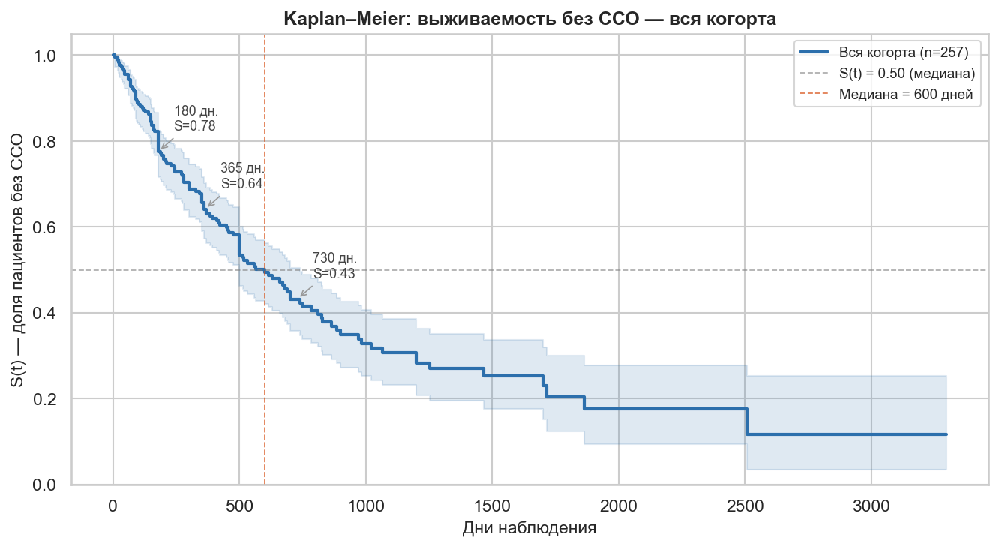
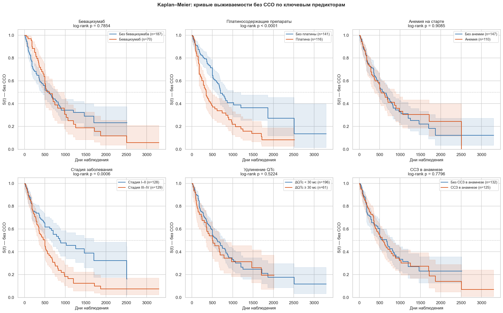
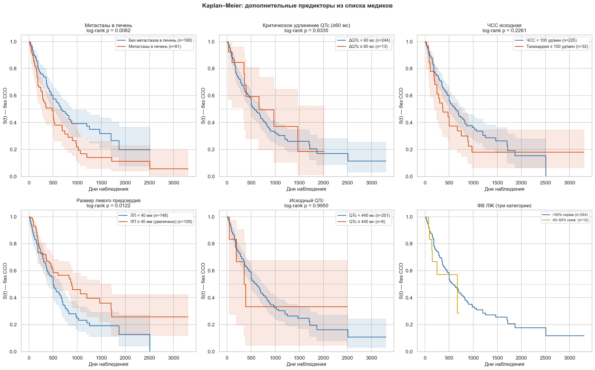
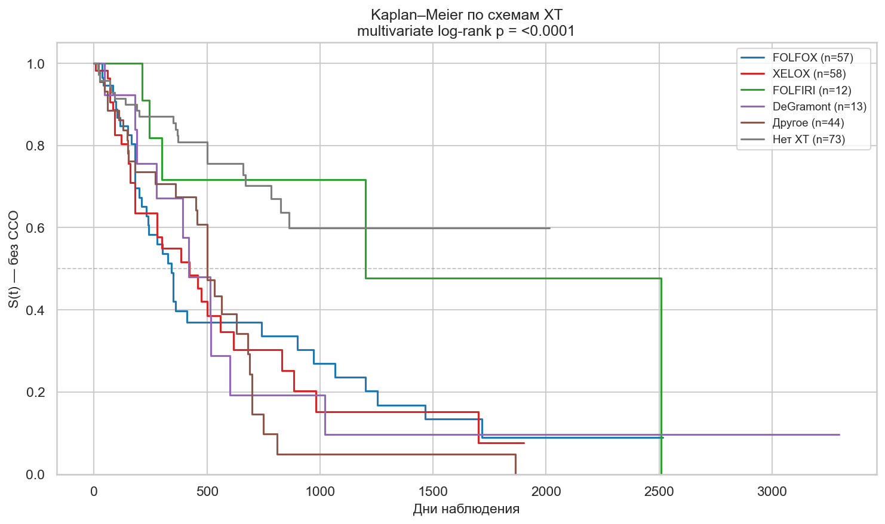
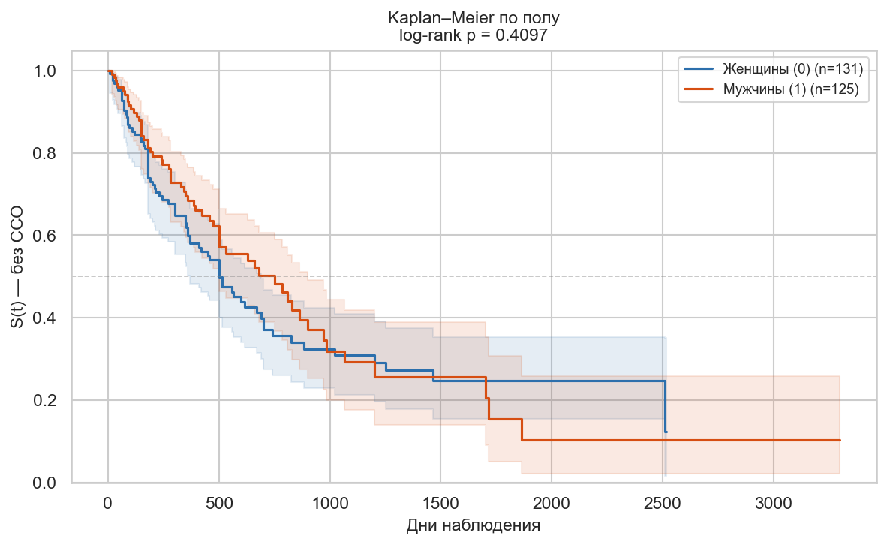
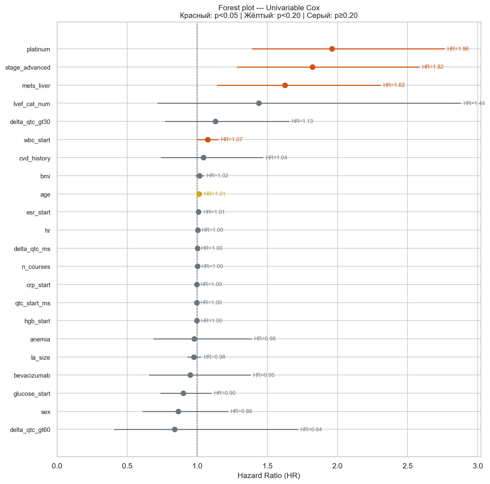
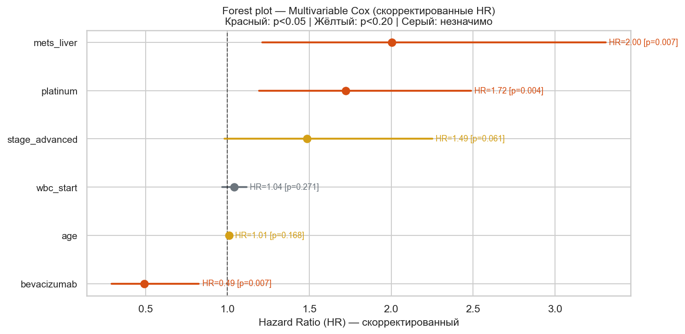

# Cardio-Oncology Survival Analysis

**Анализ выживаемости и многофакторное моделирование кардиоваскулярных
осложнений у пациентов с колоректальным раком на фоне противоопухолевого лечения.**

Репозиторий содержит исследовательский код подготовки данных, кривые
Kaplan–Meier, сравнения log-rank, модели пропорциональных рисков Cox,
субанализы и описание конкурирующих событий.

## Конференция и публикация

Результаты исследования представлены с публикацией тезисов на
**VI Всероссийской конференции с международным участием «Математика в медицине»**,
**25–26 июня 2026 года, Екатеринбург**. Участие и публикация подтверждены автором.

**Авторы работы:** О.И. Криворотько, Н.Г. Ложкина, М.Е. Тимофеев,
А.О. Юрковский, А. Этезадибехзади.

Конференция посвящена математическим методам, анализу медицинских данных,
моделированию и информационным технологиям в медицине.
[Сайт конференции](https://mathmed2026.iip.uran.ru/) ·
[Сведения о работе и конференции](docs/publication.md).

Библиографические сведения взяты из предоставленных тезисов и информационного
письма. Страницы сборника, DOI и ISBN не указаны, поскольку не предоставлены.
Исходные PDF тезисов, письма и аналитического отчёта в репозиторий не включены.

## Исследовательская задача

Оценить время до развития кардиотоксичности у пациентов с колоректальным раком
(КРР) на фоне лечения и изучить её связь с клиническими характеристиками,
стадией заболевания, метастазами и противоопухолевой терапией.
Исследование ретроспективное; терапевтические ассоциации не устанавливают
причинное действие препаратов.

| Характеристика | Значение |
|---|---:|
| Пациенты с КРР в когорте | 257 |
| Главный исход: врачебный флаг кардиотоксичности | 133 (51,8%) |
| Цензура без конкурирующей смерти | 123 |
| Конкурирующая смерть без кардиотоксичности | 1 |
| Медиана зарегистрированных длительностей | 350 дней |
| Диапазон зарегистрированных длительностей | 1–3241 день |
| Медиана Kaplan–Meier без главного события | 600 дней |
| Полные случаи основной Cox-модели | 245 пациентов, 129 событий |

Главный исход `event_cardiotox` выставлен врачом. Составной флаг `sso_any`,
сформированный объединением отдельных ССО, имеет другое определение
и не подменяет главный исход. Медиана длительностей 350 дней и медиана KM
600 дней также описывают разные величины.

## Структура проекта

```text
cardio-oncology-survival-analysis/
├── README.md
├── .gitignore
├── requirements.txt
├── pyproject.toml
├── configs/
│   ├── project.json                  # Пути и основной исход
│   └── publication.json              # Сведения о конференции и тезисах
├── notebooks/
│   ├── 01_prepare_data.ipynb          # Подготовка на основе v4 без прямых идентификаторов
│   ├── 02_survival_analysis.ipynb     # KM, Cox, субанализы и Aalen–Johansen CIF
│   └── archive/                      # Исходные версии с очищенными outputs
├── src/cardio_oncology/
│   └── paths.py                      # Переносимые пути к локальным данным
├── scripts/
│   └── run_notebooks.py              # Запуск только по явной команде
├── data/
│   ├── README.md
│   ├── data_dictionary.csv           # Публичный словарь переменных
│   └── private/                      # Клинические строки, исключены из Git
├── results/
│   ├── figures/                      # Сохранённые сводные графики
│   ├── tables/                       # Агрегаты и таблицы исходного анализа
│   └── private/                      # Локальные выходы и будущие запуски
└── docs/
    ├── methods.md                    # Аналитический разбор методов и ограничений
    └── publication.md                # Конференция, название работы, авторы
```

## Основной маршрут анализа

1. **Подготовка данных:** минимизированный клинический CSV, возраст без дат рождения,
   кодирование события и цензуры, составные ССО, преобразование QTc и ΔQTc,
   числовые признаки, винзоризация и категории ФВ, стадии и терапии.
2. **Kaplan–Meier и log-rank:** общая кривая без события и групповые сравнения
   по платине, бевацизумабу, стадии, полу, ССЗ в анамнезе, QTc и другим признакам.
3. **Cox-регрессия:** 22 одновариантных предиктора, отбор по p<0,20 и
   обязательное включение возраста, стадии и бевацизумаба в многофакторную модель.
4. **Субанализы:** пол, ОКС, значимые аритмии, тромбозы/ХСН и динамика QTc по схемам ХТ.
5. **Конкурирующие события:** CIF через Aalen–Johansen с сопоставлением с 1−KM.

В исходном коде часть блока конкурирующих рисков называлась Fine–Gray,
хотя использовались Aalen–Johansen CIF и повторная обычная Cox-модель.
В основном маршруте обозначения исправлены; повторная Cox-модель с ошибочной
меткой SHR исключена. Настоящая Fine–Gray-регрессия не выполнялась.
[Подробный разбор](docs/methods.md).

## Сохранённые результаты

Ниже представлены результаты исходного выполненного исследования.
При сборке репозитория модели и статистические тесты повторно не запускались.
Сводные таблицы перенесены из сохранённых outputs; описательные агрегаты
сформированы из предоставленного подготовленного CSV.

### Общая выживаемость без кардиотоксичности

В сохранённом расчёте S(180)=0,776, S(365)=0,642 и S(730)=0,432.
Медиана KM — 600 дней. Это оценки без главного события, а не общей выживаемости
от смерти. Интерпретация хвоста кривой зависит от числа оставшихся наблюдений.



### Основные групповые сравнения

Кривые показывают различия по платине и стадии заболевания. Изолированное
сравнение по бевацизумабу значимого расхождения не показало; это не исключает
других ассоциаций после поправки и не доказывает причинных эффектов терапии.



### Дополнительные предикторы

Исходный анализ рассматривает метастазы в печень, выраженное изменение QTc,
ЧСС, размер левого предсердия, QTc на старте и категории ФВ ЛЖ.
Граница нормальной ФВ в коде v4 — ≥50%; часть исторических подписей использует >50%.



### Схемы химиотерапии и пол

Сравнение схем отражает одновременно особенности лечения и различия пациентов;
наблюдаемые кривые не устанавливают сравнительную безопасность препаратов.





### Cox-регрессия

Сохранённая многофакторная модель использует 245 полных наблюдений и 129 событий.
Её C-index на данных подгонки — **0,658**; независимая прогнозная оценка отсутствует.

| Предиктор | Скорректированный HR | 95% ДИ | p |
|---|---:|---|---:|
| Платиносодержащие препараты | 1,723 | 1,194–2,488 | 0,0037 |
| Метастазы в печень | 2,004 | 1,213–3,310 | 0,0067 |
| Бевацизумаб | 0,491 | 0,292–0,826 | 0,0073 |
| Стадия III–IV | 1,487 | 0,982–2,250 | 0,0607 |
| Возраст, +1 год | 1,011 | 0,996–1,026 | 0,1679 |
| Лейкоциты, +1 единица | 1,041 | 0,969–1,117 | 0,2715 |

HR — отношение мгновенных интенсивностей в рамках модели, а не отношение
абсолютных вероятностей или длительностей. HR<1 для бевацизумаба описывает
наблюдаемую ассоциацию и не доказывает защитного действия.





Таблицы: [одновариантные Cox-модели](results/tables/reference_cox_univariable.csv),
[многофакторная модель](results/tables/reference_cox_multivariable.csv),
[основные log-rank сравнения](results/tables/reference_logrank_main.csv),
[описательная статистика](results/tables/descriptive_statistics.csv).

## Данные и обезличивание

Из переносимых таблиц удалены исходный номер пациента и календарные даты
рождения, диагноза и смерти. Возраст и длительности сохранены как числовые
аналитические переменные. Новые идентификаторы и таблица соответствий не создаются.
Публикуемые ноутбуки очищены от outputs, вложенных изображений и метаданных среды.

Индивидуальные клинические сочетания могут оставаться узнаваемыми даже после
удаления прямых идентификаторов. Поэтому **в Git включаются только словарь,
агрегированные результаты и сводные графики**. Клинические строки находятся в
`data/private/`, локальные результаты — в `results/private/`; оба каталога исключены
через `.gitignore`. Исходный Excel в новый проект не копируется.

После клонирования с GitHub локальных данных не будет. Для самостоятельного
пересчёта необходимы отдельно предоставленные разрешённые клинические входы.
[Формат и определения переменных](data/README.md).

## Воспроизведение по явному запросу

`requirements.txt` перечисляет используемые зависимости. Точные версии окружения
первоначального расчёта не зафиксированы; новое окружение не объявляется его точной копией.
Для отдельного запуска создайте окружение из корня проекта:

```bash
python3 -m venv .venv
source .venv/bin/activate
python -m pip install -r requirements.txt
python -m pip install --no-deps -e .
python -m ipykernel install --prefix .venv --name cardio-oncology --display-name "Python (Cardio-Oncology)"
```

На Windows активация: `.venv\Scripts\activate`. В Jupyter выберите созданное ядро.
Основная последовательность — 01, затем 02. Если используется готовый локальный
`cohort.csv`, можно начать с 02:

```bash
python scripts/run_notebooks.py --step 01
python scripts/run_notebooks.py --step 02
```

Для всей последовательности доступен `--step all`. Новые выходы и выполненные
копии ноутбуков сохраняются только в `results/private/runs/current/`.
Тесты и проверки не выполняются автоматически при сборке проекта;
это правило зафиксировано в `AGENTS.md`.
